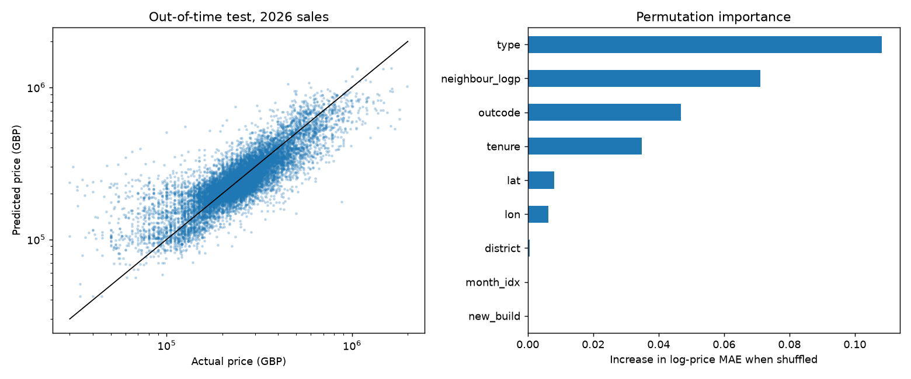

# West Midlands house price model

**Question:** how accurately can a sale price be predicted from public Land Registry data alone, and how much does a machine learning model add over a simple "median for this area and property type" lookup?

## Results (out-of-time test: 13,627 sales from January to September 2026)

The model is trained on 56,096 sales from 2024 and 2025 and tested on sales it has never seen from the following year.

| | Mean absolute error | Median % error | Within 20% of sale price | Average bias |
|---|---:|---:|---:|---:|
| Baseline: median by postcode district and type | £60,084 | 15.8% | 60.8% | -£16,305 |
| Gradient-boosted model | £50,878 | 13.7% | 66.3% | -£7,523 |

- **The model cuts mean absolute error by 15%** against the baseline and halves the bias.
- **The first version did not beat the baseline.** With only postcode-district location it matched the lookup almost exactly (£59,678 against £60,084), because it knew nothing the lookup did not. The gain came from two additions: postcode-level coordinates, and the average price of the 15 nearest sales in the training period.
- **Both still under-predict 2026 prices**, because neither can see price growth after the training period ends.
- **Detached houses are hardest** (17% median error) and terraced and semi-detached the easiest (about 12.5%).

| Property type | Test sales | Model median % error | Baseline median % error |
|---|---:|---:|---:|
| Detached | 2,254 | 16.7% | 19.1% |
| Semi-detached | 5,251 | 12.6% | 14.5% |
| Terraced | 4,416 | 12.5% | 14.8% |
| Flat | 1,706 | 17.5% | 18.6% |



Property type matters most, followed by the nearest-sales price and the postcode district. New-build status and sale month add nothing measurable.

## Method

- **Data:** HM Land Registry Price Paid Data for 2024 to 2026, filtered to the West Midlands county (Birmingham, Coventry, Dudley, Sandwell, Solihull, Walsall, Wolverhampton). Postcode coordinates come from postcodes.io.
- **Cleaning:** standard-price sales only (category A), residential types only, prices between £30,000 and £2,000,000. The bounds are fixed in advance so the test set plays no part in choosing them.
- **Features:** property type, new build, tenure, local authority, postcode district, latitude, longitude, sale month and the mean log price of the 15 nearest training sales. For training rows the sale itself is left out of its own neighbour average, so the feature does not leak the answer.
- **Model:** scikit-learn `HistGradientBoostingRegressor` on log price, with early stopping.
- **Validation:** a split by time, not a random split, because a random split lets the model see neighbouring sales from the same months it is tested on.
- **Explainability:** permutation importance on the test set.

## Limitations

- **No floor area, bedrooms or condition.** Price Paid Data does not hold them. A 14% median error is roughly what location and type alone can give; joining EPC certificates for floor area is the obvious next step and needs a registered API key.
- **No price-growth adjustment**, hence the negative bias on 2026 sales.
- **One region only.** The model has not been tested elsewhere.
- The Streamlit app predicts from the centre of a postcode district, so it is less precise than the test figures above.

## Run

```bash
pip install -r requirements.txt
```

```bash
python pipeline.py
```

```bash
python -m pytest
```

```bash
streamlit run app.py
```

The pipeline downloads about 420 MB from Land Registry on first run, keeps only the West Midlands rows, and regenerates every figure above in `reports/metrics.json`.

## Data licence

Contains HM Land Registry data © Crown copyright and database right 2026. This data is licensed under the Open Government Licence v3.0. Postcode data from postcodes.io (Ordnance Survey and ONS open data).
